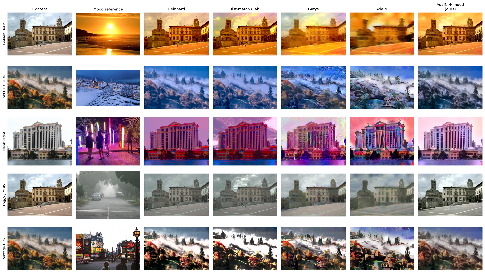
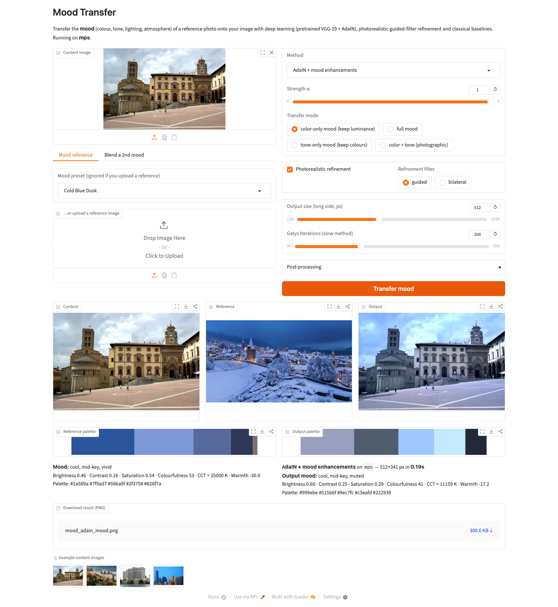
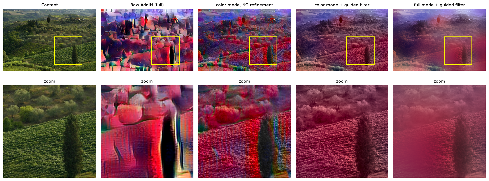
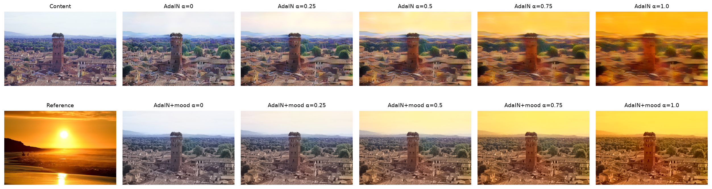
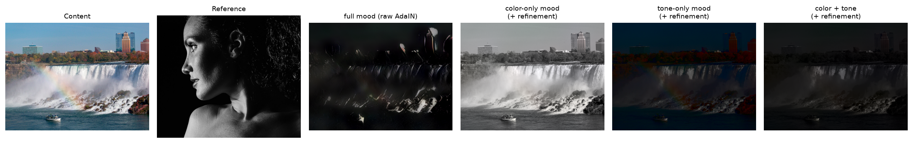
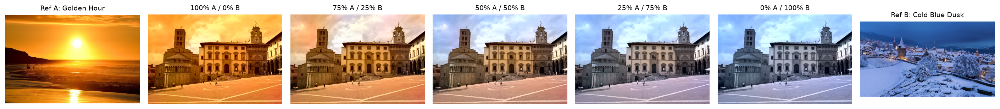
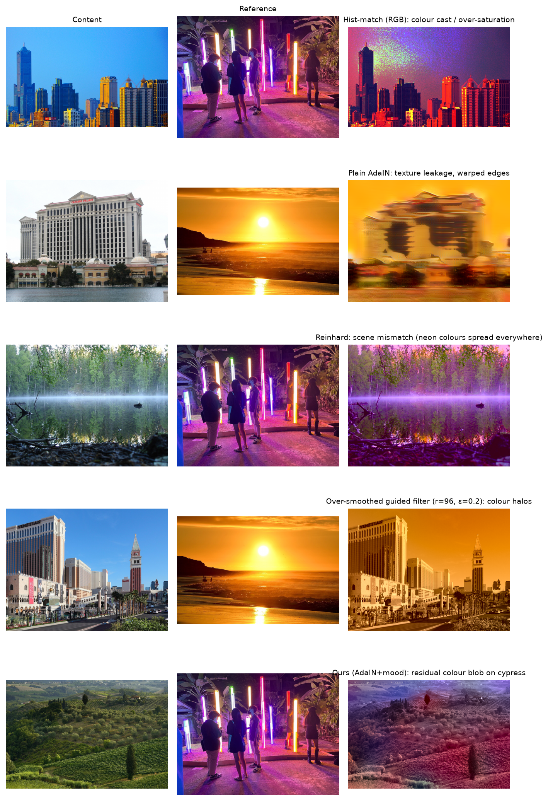
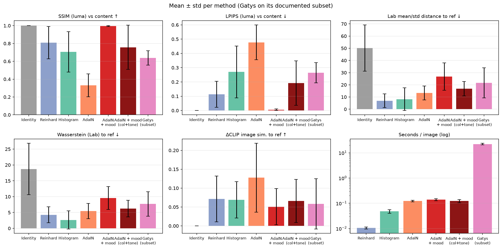

# Mood Transfer
roll no: 23L-3002 , 23L-0903
**Using deep learning to transfer the mood (look, feel and atmosphere) of one image to another.**
Digital Image Processing semester project.

Given a **content** photo A and a **mood/reference** photo B (golden hour, cold blue dusk, fog, neon night,
vintage film, dark noir…), the system re-renders A with B's colour palette, tone, lighting and atmosphere
while keeping A's structure, edges and objects, and the output still looks like a photograph.



* **Deep learning core:** pretrained VGG-19 features, used by
  * **Gatys et al.** optimisation (content + Gram-matrix style + TV loss, L-BFGS), and
  * **AdaIN** fast feed-forward transfer (pretrained encoder/decoder), with strength α and
    multi-reference blending.
* **Mood layer (the "mood" in mood transfer):** Lab transfer modes (full / color-only / tone-only /
  color+tone), **photorealistic refinement** with a colour guided filter using the content as guide,
  mood descriptors (Lab k-means palette, brightness, contrast, saturation, colour temperature, label),
  6 presets, post-processing (histogram refinement, bilateral smoothing, sharpening, grain, vignette),
  and DeepLabV3 semantic foreground/background transfer.
* **Classical DIP baselines from scratch:** Reinhard colour transfer (Lab) and CDF histogram matching (RGB/Lab).
* **Evaluation:** 10 contents × 6 moods; SSIM, LPIPS, Lab statistics, Wasserstein and Bhattacharyya
  distances, CLIP similarity, runtime on CPU and GPU.
* **Interfaces:** Gradio GUI, CLI with batch mode, a Colab-friendly notebook, and pytest tests.

---

## 1. Installation

Tested with **Python 3.13.5** on macOS (Apple M5, PyTorch **MPS** GPU) and CPU. The code picks
**CUDA → MPS → CPU** automatically and prints the device.

```bash
cd mood-transfer
python3 -m venv .venv
source .venv/bin/activate            # Windows: .venv\Scripts\activate
pip install -r requirements.txt      # CUDA users: install the CUDA torch build from pytorch.org first
python scripts/download_weights.py   # downloads + verifies ALL weights (~1.3 GB), fails fast if offline
pytest -q                            # 28 tests, ~3 s
```

`download_weights.py` fetches and verifies (sizes plus a load test) everything used anywhere:

| Weights | Source | Used by | Pretrained / trained by us |
|---|---|---|---|
| AdaIN decoder `decoder.pth` | [naoto0804/pytorch-AdaIN](https://github.com/naoto0804/pytorch-AdaIN) release v0.0.0 | AdaIN, AdaIN + mood | pretrained (MS-COCO + WikiArt, by the repo author) |
| Normalised VGG-19 `vgg_normalised.pth` | same release | AdaIN encoder | pretrained |
| torchvision VGG-19 `IMAGENET1K_V1` | torchvision | Gatys | pretrained (ImageNet) |
| LPIPS (AlexNet) | `lpips` package | metric | pretrained |
| CLIP ViT-B/32 `laion2b_s34b_b79k` | `open_clip` | metric | pretrained |
| DeepLabV3-MobileNetV3-Large | torchvision | semantic mode | pretrained (COCO subset, VOC classes) |

**Nothing was trained in this project.** `scripts/train_adain.py` was not needed because the pretrained
AdaIN decoder was available (see `CHECKLIST.md`).

### Which VGG-19 does each method use, and why?
* **AdaIN** uses the *normalised* VGG-19 that ships with the pretrained decoder. A decoder can only
  invert the exact feature space it was trained on. That network's first 1×1 convolution already
  contains the original Caffe preprocessing, so AdaIN takes **plain RGB in [0, 1] without ImageNet
  normalisation**. We verified compatibility visually: at α = 0, `decoder(encoder(content))` reproduces
  the content image.
* **Gatys** uses **torchvision's ImageNet VGG-19** with ImageNet mean/std normalisation. Gatys only
  optimises pixels, so any good VGG feature space works.

---

## 2. Usage

### GUI (Gradio)
```bash
python app.py            # open http://127.0.0.1:7860   (--share for a public link)
```
Upload a content image, then upload a reference or pick a preset. Choose the method, α, transfer mode,
refinement, post-processing sliders and output size. The page shows content, reference and output side
by side, plus palettes and mood statistics for reference and output, and a PNG download. A second
reference plus a blend weight gives multi-mood blending. On CPU the Gatys size is capped at 256 px with
a warning.



### CLI
```bash
# exactly the requested interface (--style is an alias of --mood)
python run.py --content a.jpg --mood b.jpg --method adain --alpha 0.8 --mode full --out out.png

# recommended photographic pipeline (default): AdaIN + colour-only mode + guided-filter refinement
python run.py --content data/content/lucca_rooftops.jpg --preset "Golden Hour" --out out.png --describe

# other methods: reinhard | hist | gatys | adain | adain_mood
python run.py --content a.jpg --style b.jpg --method gatys --iters 300 --size 384 --out g.png   # also saves g_loss.png
python run.py --content a.jpg --mood b.jpg --method hist --hist-space rgb --out h.png

# modes and post-processing
python run.py --content a.jpg --mood b.jpg --method adain_mood --mode color_tone --grain 0.3 --vignette 0.4 --sharpen 0.5 --out o.png

# multi-reference blending (70 % golden hour + 30 % blue dusk)
python run.py --content a.jpg --preset golden_hour blue_dusk --weights 0.7 0.3 --out blend.png

# batch: every content in a folder × every mood in a folder
python run.py --batch --content data/content --mood data/moods --method adain_mood --out results/batch

python run.py --list-presets
```
Key options: `--alpha [0,1]`, `--mode {full,color,tone,color_tone}`, `--refine/--no-refine`,
`--refine-method {guided,bilateral}`, `--size` (default 512 on GPU, 384 on CPU), `--device`, `--seed`.

### Reproduce every result and figure
```bash
python scripts/run_experiments.py --speed     # ~20 min on Apple M5 (MPS); writes results/ and report/figures/
python scripts/export_pdf.py                  # report/report.md -> report/report.pdf

# optional end-to-end GUI check (pip install playwright gradio_client; uses the installed Chrome)
python app.py &  python scripts/check_gui.py  # drives every method via the API + a real browser, saves the screenshot
```

---

## 3. Results

All numbers are from real runs (`python scripts/run_experiments.py --speed`) on an Apple M5 laptop
(MPS GPU). Raw per-pair values: [`results/metrics.csv`](results/metrics.csv). Aggregates:
[`results/metrics_summary.md`](results/metrics_summary.md). Speed: [`results/speed.csv`](results/speed.csv).

**Full grid: 10 contents × 6 moods = 60 pairs per method, 512 px (mean ± std).**

| Method | SSIM ↑ | LPIPS ↓ | Lab stat dist ↓ | Wasserstein ↓ | ΔCLIP img ↑ | ΔCLIP text ↑ | s/img (MPS) |
|---|---|---|---|---|---|---|---|
| Identity (content unchanged) | 1.000 | 0.000 | 50.1 ± 19.0 | 18.73 ± 8.09 | 0.000 | 0.000 | – |
| Reinhard (Lab) | 0.809 ± 0.182 | 0.114 ± 0.091 | **6.9 ± 5.6** | 4.28 ± 2.50 | 0.071 ± 0.061 | 0.089 ± 0.051 | **0.010** |
| Histogram matching (Lab) | 0.706 ± 0.227 | 0.270 ± 0.182 | 8.2 ± 9.4 | **2.66 ± 2.84** | 0.069 ± 0.048 | 0.083 ± 0.045 | 0.048 |
| AdaIN | 0.331 ± 0.128 | 0.477 ± 0.122 | 13.3 ± 5.7 | 5.43 ± 2.42 | **0.128 ± 0.091** | 0.096 ± 0.062 | 0.122 |
| **AdaIN + mood (default: color mode + guided filter)** | **0.996 ± 0.004** | **0.006 ± 0.006** | 26.8 ± 11.2 | 9.57 ± 3.60 | 0.051 ± 0.048 | 0.086 ± 0.036 | 0.139 |
| **AdaIN + mood (color+tone mode)** | 0.757 ± 0.248 | 0.192 ± 0.155 | 16.8 ± 6.0 | 6.27 ± 2.62 | 0.066 ± 0.057 | **0.108 ± 0.050** | 0.123 |

**Gatys (documented subset):** 3 contents (arezzo_piazza, autumn_hills, caesars_palace) × 6 moods = 18
pairs at **384 px, 300 L-BFGS evaluations**: SSIM 0.638 ± 0.080, LPIPS 0.265 ± 0.071, Lab stat dist
21.6 ± 12.4, ΔCLIP text 0.072 ± 0.040, **22.2 s/img**. On the same 18 pairs, AdaIN + mood scored SSIM
0.998 and ΔCLIP text 0.088 (color mode) / 0.112 (color+tone). The full subset table is in the report
(Table 2).

**Speed (s/img, mean of 3):** AdaIN + mood **0.10 s on MPS / 0.39 s on CPU**; plain AdaIN 0.09 / 0.55;
Gatys (384 px, 300 it.) 20.6 / 57.9; Reinhard 0.01; histogram matching 0.04.

**Takeaways.**
* Our default pipeline is the only deep method that keeps the photo intact (SSIM 0.996 vs. 0.331 for
  plain AdaIN and 0.638 for Gatys) while visibly moving the mood: it halves the colour-statistics
  distance and matches CLIP mood prompts as well as Reinhard.
* The color+tone mode has the best text-described mood match of all methods (ΔCLIP 0.108). Its lower
  SSIM comes almost entirely from Dark Noir (0.23, deliberately darkened); on the other 5 moods it is 0.86.
* The classical methods match global colour statistics best, because that is exactly what they
  optimise, but they spread colours without regard to content (see failure cases).
* AdaIN + mood is ~200× faster than Gatys on the same GPU.

| | |
|---|---|
|  |  |
| Photorealistic refinement: raw AdaIN → colour mode → + guided filter (SSIM 0.22 → 0.98 → 0.994) | α sweep: AdaIN (top) vs AdaIN + mood (bottom) |
|  |  |
| Transfer modes (noir reference) | Multi-reference blending (golden hour ↔ blue dusk) |
|  |  |
| Failure cases | Metrics, mean ± std |

All figures are in [`report/figures/`](report/figures/) and the full report is in
[`report/report.md`](report/report.md) / [`report/report.pdf`](report/report.pdf).

---

## 4. Repository layout

```
app.py                 Gradio GUI
run.py                 CLI (single, multi-reference, batch)
src/utils.py           device, seeding, I/O (BGR<->RGB), resize/pad, colour-space helpers
src/models.py          normalised VGG-19 + AdaIN decoder; torchvision VGG-19 feature extractor
src/classical.py       Reinhard (Lab) and CDF histogram matching, from scratch
src/gatys.py           Gatys et al. (L-BFGS/Adam, content init, Gram style loss, TV, loss curves)
src/adain.py           AdaIN transfer, alpha, multi-reference statistics blending, tiled mode
src/mood.py            transfer modes, guided filter, refinement, descriptors, presets, post-processing, semantic
src/pipeline.py        single dispatch used by CLI, GUI and experiments
src/metrics.py         SSIM, LPIPS, Lab stats, Wasserstein, Bhattacharyya, CLIP
scripts/download_weights.py   all weights, verified
scripts/run_experiments.py    all results, metrics.csv, figures
scripts/fetch_commons.py      licence-filtered image download (Wikimedia) + metadata
scripts/make_credits.py       copies selected images into data/ and writes CREDITS.md
scripts/export_pdf.py         Markdown -> PDF (pandoc / headless Chrome / WeasyPrint)
scripts/check_gui.py          end-to-end GUI test (gradio_client + Playwright) and screenshot
scripts/selection.json        which downloaded candidate became which data/ file
data/content, data/moods      10 content + 6 mood images, each folder with CREDITS.md
results/                      outputs/<method>/*.png, metrics.csv, metrics_summary.{csv,md}, speed.csv, figures/
report/                       report.md/.pdf, slides_outline.md, viva_prep.md, figures/
notebooks/demo.ipynb          Colab-friendly walkthrough
tests/test_basic.py           pytest smoke + property tests
```

---

## 5. Limitations

* **Colour-only (default) mode under-transfers brightness-driven moods.** Noir and night become clean
  black-and-white or tinted daylight photos rather than dark ones. Use `--mode color_tone` or `tone` for those.
* **No relighting.** Global statistics can't move shadows or add light sources; a midday photo stays lit from above.
* **Scene mismatch** (e.g. a neon street applied to a forest) yields implausible colour placement for
  every method.
* **Residual AdaIN colour blobs** on small objects can survive the refinement (failure case 5 in the report).
* **AdaIN α = 0 is only an approximate reconstruction** (decoder(encoder(x)); SSIM ≈ 0.60 at 512 px,
  0.29–0.71 at 128–256 px depending on image detail). In the mood pipeline α = 0 does return the content
  (SSIM > 0.99) because luminance comes from the content.
* **Gatys was evaluated on a subset** (18 pairs, 384 px, 300 iterations) because of its runtime.
* **No CUDA GPU was available.** "GPU" numbers are Apple MPS; the code supports CUDA but CUDA timings were not measured.
* **Metrics are proxies** (SSIM penalises intended tone changes; colour-statistics metrics favour the
  classical methods; CLIP image similarity rewards copied texture). No user study was run; a template is in the report appendix.
* **Semantic mode** uses PASCAL-VOC classes (no "sky"); none of the 10 landscape/city test images contain
  VOC objects, so it is demonstrated on a separate public-domain portrait.
* The mood-label thresholds are hand-set on the 6 presets, and the McCamy CCT estimate saturates
  (25 000 K clip) for strongly coloured images.
* `report.pdf` is ~33 MB because figures are embedded as full-resolution PNGs.

---

## 6. Image credits and ethics
All 16 test images come from Wikimedia Commons under CC0, CC BY or CC BY-SA licences. Authors, licences
and source URLs are listed in [`data/content/CREDITS.md`](data/content/CREDITS.md) and
[`data/moods/CREDITS.md`](data/moods/CREDITS.md). The extra demo image is NASA public domain
([`data/extra/CREDITS.md`](data/extra/CREDITS.md)). Mood transfer is a form of image manipulation:
edited photographs used in journalism, evidence or advertising should be disclosed as edited.
# DIP--Mood-transfer
