# Mood Transfer: Using Deep Learning to Transfer the Mood of One Image to Another

**Digital Image Processing — Semester Project Report**

---

## Abstract

We present a system that re-renders a *content* photograph with the **mood** (colour palette, tone,
lighting and atmosphere) of a *reference* photograph while preserving the content's structure. The deep
learning core is a pretrained VGG-19 feature space used in two ways: optimisation-based neural transfer
(Gatys et al.) and fast feed-forward Adaptive Instance Normalisation (AdaIN, Huang & Belongie). Plain
neural style transfer paints textures onto photographs, which conflicts with the goal of a
photographic result. We therefore add a *mood layer* built from classical DIP tools: luminance-preserving
transfer modes in CIELab, a photorealistic refinement step based on a colour guided filter that uses the
content image as guide, mood descriptors (Lab k-means palette, brightness, contrast, saturation,
correlated colour temperature), presets, multi-reference blending, post-processing and an optional
semantic (DeepLabV3) foreground/background mode. Classical baselines (Reinhard colour transfer, CDF
histogram matching) are implemented from scratch. We evaluate five methods on 10 content images ×
6 moods with SSIM, LPIPS, Lab statistics, Wasserstein and Bhattacharyya histogram distances, CLIP
similarity and runtime. Our default pipeline (AdaIN + colour-only mode + guided-filter refinement)
preserves structure almost perfectly (luminance SSIM 0.996, LPIPS 0.006, vs. 0.331 / 0.477 for plain
AdaIN). It halves the colour-statistics distance to the reference and matches CLIP mood descriptions
as well as Reinhard, at ~0.1 s per 512 px image on a laptop GPU (≈200× faster than Gatys). A
colour+tone mode trades some SSIM for the strongest text-described mood match of all methods (ΔCLIP
0.108).

---

## 1. Introduction

### 1.1 What is "mood" in an image?
Photographers and film colourists talk about the *mood* or *atmosphere* of an image: the warm, low sun of
golden hour, the cold blue of dusk, the low-contrast greys of fog, the saturated magenta–cyan of neon
night, the faded, shifted colours of old film stock, or the dark, high-contrast look of film noir. These
impressions are carried mostly by **global photometric properties**:

* **colour palette and colour temperature** (warm ↔ cool white balance, dominant hues),
* **tone**: overall brightness (low-key/high-key) and contrast (the tone curve),
* **saturation / colourfulness**,
* **lighting and haze** (the spatial distribution of brightness, glow, veiling light).

Artistic style, in contrast, also includes **texture**: brush strokes, canvas, patterns. For photographs,
transferring texture is usually *undesirable*: the output should still look like a photograph.

### 1.2 Problem statement
Given a content image **A** and a mood/reference image **B**, produce an image that

1. has the colour, tone and atmosphere of **B**,
2. preserves the structure, edges and objects of **A** (recognisable, with no warped edges),
3. contains no unpleasant artefacts (painterly textures, halos, colour blotches), and
4. is produced with deep learning as the core method, quickly enough for interactive use.

### 1.3 Contributions
* A complete, modular implementation of **four families of methods**: classical Reinhard and histogram
  matching (from scratch), Gatys optimisation, AdaIN feed-forward transfer, and **AdaIN + mood
  enhancements**, our photographic pipeline.
* A **mood layer** that separates colour, tone and texture: four transfer modes, guided-filter
  photorealistic refinement, mood descriptors and presets, multi-reference blending, post-processing and
  semantic foreground/background transfer.
* A quantitative evaluation on 60 content–mood pairs with seven metrics plus runtime, and qualitative
  studies (α sweep, modes, refinement, blending, failure cases).
* A CLI with batch mode, a Gradio GUI, tests, and a reproducible experiment script.

---

## 2. Related Work

**Statistical colour transfer.** Reinhard et al. [1] transfer colour by matching the mean and standard
deviation of each channel in the decorrelated lαβ opponent colour space. Histogram specification
(matching full channel distributions via their cumulative distribution functions) is a textbook DIP
technique [16]. Pitié et al. [22] extended this to N-dimensional PDF transfer. These methods are fast and
structure-preserving but blind to spatial and semantic content.

**Optimisation-based neural style transfer.** Gatys et al. [2] showed that deep features of an
ImageNet-trained VGG network [8] separate content (feature maps of a deep layer) from style (Gram
matrices of feature maps across layers). An output image is obtained by optimising its pixels to match
both. Li et al. [19] showed that Gram matching is equivalent to minimising a Maximum Mean Discrepancy
between feature distributions, which motivates matching simpler feature statistics.

**Fast feed-forward transfer.** Johnson et al. [4] trained a feed-forward network per style with
perceptual losses for real-time transfer. Ulyanov et al. [20] showed that instance normalisation
improves stylisation. Huang & Belongie [3] proposed **Adaptive Instance Normalisation (AdaIN)**: aligning
the channel-wise mean and variance of content features to those of the style features, followed by a
learned decoder. This gives *arbitrary* style transfer in a single forward pass.

**Photorealistic style transfer.** Luan et al. [5] (Deep Photo Style Transfer) add a photorealism
regulariser that constrains the transformation to be *locally affine in colour space* (based on the
Matting Laplacian), plus semantic segmentation to avoid content mismatches. Li et al. [6] (PhotoWCT)
replace the decoder's upsampling with unpooling and add a closed-form **smoothing step** that makes
pixels with similar content colours receive similar outputs. Yoo et al. [25] (WCT²) use wavelet pooling.
The guided filter of He et al. [7] is an efficient, edge-preserving local linear model and is closely
related to the matting Laplacian used by Luan et al. Our refinement step borrows this idea.

---

## 3. DIP Fundamentals Used

| Concept | Where it is used |
|---|---|
| **Colour spaces** (RGB, CIELab, YCbCr, HSV) | Reinhard and histogram transfer in Lab; transfer modes split L* (structure) from a*, b* (colour); YCbCr helpers; HSV saturation in the descriptor |
| **Histograms, CDFs, histogram specification** | Histogram-matching baseline; tone-only mode (tone curve = CDF matching of L*); histogram refinement post-process; Wasserstein/Bhattacharyya metrics |
| **First/second-order statistics** (mean, std, covariance) | Reinhard; AdaIN (on deep features); guided filter (local mean/covariance); Lab-statistics metric |
| **Convolution** | VGG-19 encoder/decoder (3×3 convs, reflection padding); Gaussian blur in unsharp masking and film grain; box filters |
| **Spatial filtering, edge-preserving smoothing** | Guided filter (photorealistic refinement, semantic-mask refinement); bilateral filter (option and post-process) |
| **Sharpening** | Unsharp masking post-process |
| **Normalisation statistics** | Instance normalisation / AdaIN; ImageNet normalisation for torchvision VGG |
| **Resampling** | Aspect-preserving resize (INTER_AREA when downsampling for anti-aliasing), reflection padding to multiples of 8 |
| **Clustering** | k-means in Lab for the dominant palette |
| **Colorimetry** | sRGB → linear → XYZ → (x, y) chromaticity → McCamy correlated colour temperature |

**Colour spaces.** RGB channels are highly correlated: a brightness change moves all three. CIELab
separates lightness L* ∈ [0, 100] from two opponent chroma axes, a* (green–red) and b* (blue–yellow). It
is approximately perceptually uniform, so Euclidean distances roughly follow perceived differences. This
gives two properties we rely on: (i) per-channel statistics can be matched independently without
creating colour casts, and (ii) *structure* (edges, texture) lives mostly in L*, so replacing a*, b* changes
colour while keeping the structure.

**Histogram specification.** For a channel with CDF T(r) and a reference with CDF G(z), the mapping
z = G⁻¹(T(r)) produces an output whose histogram approximates the reference's. Our implementation uses
1024-bin CDFs with linear interpolation, and drops flat CDF segments so that the inverse is well defined.

**Guided filter [7].** For guide I and input p, the output in every window ω_k of radius r is modelled as
q_i = a_kᵀ I_i + b_k. Least-squares fitting with regulariser ε gives

```
a_k = (Σ_k + εU)⁻¹ · cov_k(I, p)          b_k = mean_k(p) − a_kᵀ · mean_k(I)
q_i = mean_{k∋i}(a_k)ᵀ · I_i + mean_{k∋i}(b_k)
```

where Σ_k is the 3×3 covariance of the colour guide in the window. All terms are box-filter means, so the
cost is O(1) per pixel, independent of r. Because ∇q ≈ a ∇I, **the output can only have edges where the
guide has edges**. This is exactly the property needed to remove hallucinated textures from a stylised
image while keeping the content's edges.

---

## 4. Methodology

### 4.1 Method 0 — Classical baselines (`src/classical.py`)
* **Reinhard** in CIELab: `out_c = (x_c − μ_c^A)·σ_c^B/σ_c^A + μ_c^B` for c ∈ {L, a, b}.
* **Histogram matching** per channel (CDF matching) in RGB or Lab (Lab is used in the evaluation; RGB
  appears in the failure analysis).

Both expose a strength α (pixel blend; α = 0 returns the content exactly, which the tests verify).

### 4.2 Method 1 — Gatys et al. optimisation (`src/gatys.py`)
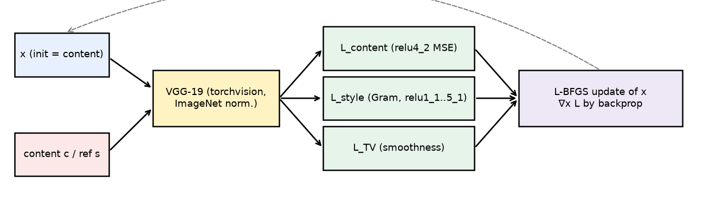

With F_l(x) the VGG-19 activations at layer l and G_l = F_l F_lᵀ / (C_l H_l W_l):

```
L_content = mean( (F_relu4_2(x) − F_relu4_2(c))² )
L_style   = Σ_{l ∈ {relu1_1, relu2_1, relu3_1, relu4_1, relu5_1}} (1/5) · mean( (G_l(x) − G_l(s))² )
L_TV      = mean|x_{i+1,j} − x_{i,j}| + mean|x_{i,j+1} − x_{i,j}|
L         = w_c·L_content + w_s·L_style + w_tv·L_TV,   w_c = 1, w_s = 1e5, w_tv = 1e-2
```

The image x is **initialised from the content image**, so the result stays photographic and converges
faster. It is optimised with L-BFGS [24] (or Adam). Max-pooling is replaced by average pooling, as
suggested by Gatys et al. The VGG is torchvision's ImageNet VGG-19 with ImageNet mean/std normalisation.

### 4.3 Method 2 — AdaIN feed-forward transfer (`src/adain.py`, `src/models.py`)
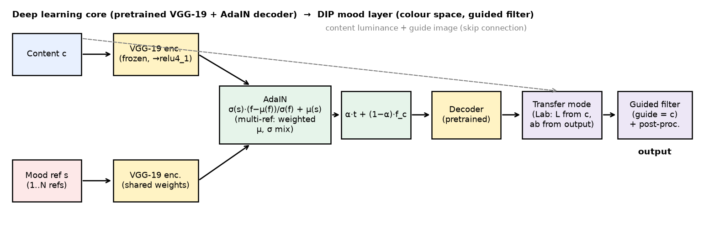

```
f_c = E(c),  f_s = E(s)                     E = normalised VGG-19 up to relu4_1 (frozen)
AdaIN(x, y) = σ(y) · (x − μ(x)) / σ(x) + μ(y)      (per channel, spatial statistics)
t = α · AdaIN(f_c, f_s) + (1 − α) · f_c            (strength α ∈ [0, 1])
output = D(t)                                      D = pretrained decoder (mirror of E)
```

* **Multi-reference blending.** Target statistics are mixed, μ = Σ wᵢ μ(f_sᵢ), σ = Σ wᵢ σ(f_sᵢ). Since
  AdaIN is affine in (μ, σ), this equals mixing the AdaIN outputs.
* **Odd sizes.** Inputs are reflect-padded to a multiple of 8 (three pooling stages / ×8 upsampling) and
  cropped back afterwards.
* **Large images.** Optional tiled decoding with *global* content statistics and feathered overlaps
  (no seams), for memory safety.
* **Encoder/decoder compatibility.** The decoder only inverts the feature space it was trained on, so we
  use the normalised VGG-19 released with it. Its first 1×1 convolution contains the original Caffe
  preprocessing, so the input is plain RGB in [0, 1] with **no ImageNet normalisation** (Section 6.2).

### 4.4 Method 3 — Mood-aware enhancements (`src/mood.py`)
**Transfer modes** (applicable to the output of any method), in CIELab:

| Mode | L* (structure, brightness) | a*, b* (colour) |
|---|---|---|
| `full` | from transfer output | from transfer output |
| `color` (default for AdaIN + mood) | **content** | transfer output (guided-filtered) |
| `tone` | content L* remapped by a global monotone tone curve towards the output's L* distribution (CDF matching) | content (saturation-compensated) |
| `color_tone` | tone curve as above | transfer output (guided-filtered) |

A global monotone curve preserves pixel ordering, so it cannot create or move edges. This lets the tone
modes transfer brightness and contrast without touching structure.

**Photorealistic refinement.** The AdaIN output is filtered with the colour guided filter, using the
content image as guide (r = long side / 16, i.e. 32 px at 512 px, ε = 10⁻²; chosen empirically, Section 6). Within each window the
refined output is a *locally affine function of the content colours*. This is the same assumption as
Luan et al.'s photorealism regulariser [5] and PhotoWCT's smoothing step [6], but computed in closed
form in O(N). AdaIN's hallucinated textures are not explained by the guide, so they are averaged away.
Edges present in the content are kept.

**Mood descriptor.** A five-colour palette from k-means in Lab (with share-proportional swatches), mean
L* (brightness), std L* (RMS contrast), mean HSV saturation, Hasler–Süsstrunk colourfulness [18], and
the correlated colour temperature of the mean colour via McCamy's formula [17]
(CCT = 449n³ + 3525n² + 6823.3n + 5520.33, n = (x − 0.3320)/(0.1858 − y)), combined into a rule-based
label such as "warm, mid-key, vivid".

**Presets.** Six named moods in `data/moods/`: Golden Hour, Cold Blue Dusk, Foggy/Misty, Neon Night,
Vintage Film and Dark Noir.

**Post-processing** (sliders, all off by default): chroma histogram refinement towards the reference,
bilateral edge-preserving smoothing, unsharp-mask sharpening, luminance film grain weighted towards
mid-tones, and a radial vignette.

**Semantic-aware transfer (stretch goal).** A pretrained DeepLabV3-MobileNetV3 [13, 14] gives
P(background). Its complement (a soft foreground-object mask) is refined with a guided filter and used
to blend a full-strength mood on the background with a weaker (α = 0.35) or different mood on the
foreground objects.

---

## 5. Implementation Details

### 5.1 Data
* **Content set (10 images):** Arezzo Piazza Grande, autumn hills in mist, Caesars Palace (Las Vegas),
  Kaohsiung skyline, forest lake in morning mist, Las Vegas Strip (The Venetian), Lucca rooftops,
  Matterhorn south face, Niagara American Falls, Chianti vineyard landscape. They cover architecture,
  cityscapes, landscapes, water, foliage and fine texture.
* **Mood set (6 references):** Golden Hour (beach sunset), Cold Blue Dusk (snowy town at blue hour),
  Foggy/Misty (foggy street), Neon Night (neon light installation at night), Vintage Film (Piccadilly
  Circus, 1962 colour slide) and Dark Noir (low-key black-and-white portrait).
* All 16 images are from **Wikimedia Commons** under CC0 / CC BY / CC BY-SA licences. We retrieved
  author and licence metadata through the Wikimedia API (`scripts/fetch_commons.py` keeps only
  CC0/PD/CC BY/CC BY-SA files) and list them in `data/*/CREDITS.md`. Images were resized to ≤1600 px.
  One extra public-domain NASA image (scikit-image's *astronaut*) is used only for the semantic demo,
  because the landscape set contains no PASCAL-VOC objects.

### 5.2 Weights (all pretrained; nothing trained in this project)

| Component | Weights | Input preprocessing |
|---|---|---|
| AdaIN encoder | normalised VGG-19 (`vgg_normalised.pth`, naoto0804/pytorch-AdaIN), truncated at relu4_1 | raw RGB in [0, 1]; the first 1×1 conv performs the Caffe BGR/mean preprocessing |
| AdaIN decoder | `decoder.pth` (same release; trained by its author on MS-COCO [21] content + WikiArt style) | relu4_1 features → RGB |
| Gatys | torchvision VGG-19 `IMAGENET1K_V1` (max-pool → avg-pool) | ImageNet mean/std normalisation |
| LPIPS metric | AlexNet + LPIPS v0.1 linear layers | [−1, 1] |
| CLIP metric | open_clip ViT-B/32, `laion2b_s34b_b79k` [11, 12] | CLIP preprocessing |
| Semantic mode | torchvision DeepLabV3-MobileNetV3-Large (VOC labels) [13, 14, 23] | ImageNet normalisation |

**Compatibility check.** With α = 0 the AdaIN path computes `decoder(encoder(content))`. The result
clearly reproduces the content (Figure "alpha sweep", first column), which confirms that the encoder and
decoder match. A mismatched encoder (e.g. torchvision VGG with ImageNet normalisation) produces
unrecognisable output. Reconstruction is approximate: SSIM to the content was 0.60 at 512 px and
0.29–0.71 at 128–256 px, depending on image detail, because the decoder was trained with content+style
losses rather than for exact reconstruction, and relu4_1 has 1/8 resolution.

### 5.3 Hyper-parameters

| Setting | Value |
|---|---|
| Working size (long side) | 512 px on GPU/MPS (default 384 px on CPU) |
| Gatys | w_c = 1, w_s = 1e5, w_tv = 1e-2, L-BFGS (history 50), 300 function evaluations, init = content, 384 px |
| AdaIN | α = 1 (evaluation), statistics at relu4_1, ε = 1e-5 in σ |
| Guided filter (refinement) | colour guide = content, r = long side / 16 (32 px at 512 px), ε = 1e-2 |
| Transfer mode for "AdaIN + mood" | `color` (default); `color_tone` and `tone` shown in the mode study |
| Histogram matching | 1024 bins, Lab (evaluation), RGB (failure analysis) |
| Palette | k-means, k = 5, Lab, 160 px thumbnail, k-means++ init, 4 attempts |
| Seeds | Python/NumPy/PyTorch seed 0 (`set_seed`) |

### 5.4 Gatys evaluation subset
Gatys is ~100× slower than the feed-forward methods, so it was run on a **documented subset**: the first
three content images in alphabetical order (**arezzo_piazza, autumn_hills, caesars_palace**) × all six
moods = **18 pairs, at 384 px, 300 L-BFGS function evaluations**. All other methods run on the full
10 × 6 = 60 pairs at 512 px. To make the comparison fair, the results table also reports every method
restricted to the same 18 pairs.

### 5.5 Hardware and software
Apple M5 laptop with 16 GB unified memory, PyTorch 2.15.0 using the **MPS** (Metal) GPU backend; no CUDA
GPU was available. CPU timings use the same machine. Python 3.13.5, torchvision 0.29.2, OpenCV 5.1,
scikit-image 0.26, lpips 0.1.4, open_clip 4.2.2, Gradio 6.32. Timings are wall-clock with device
synchronisation, after a warm-up run, and include pre-/post-processing at the working size but not disk I/O.

---

## 6. Experiments and Results

All numbers and figures in this section come from `python scripts/run_experiments.py --speed`. The raw
per-pair values are in `results/metrics.csv` (378 rows) and the aggregates in
`results/metrics_summary.{csv,md}`, `results/speed.csv`, `results/gf_ablation.json` and
`results/refinement_ssim.json`.

### 6.1 Metrics
* **Content preservation** (output vs. content): **SSIM** [9] and **LPIPS** [10], both on *luminance*,
  because a mood change is supposed to change colour.
* **Mood match** (output vs. reference): **Lab statistics distance** ‖Δμ‖ + ‖Δσ‖ over (L*, a*, b*);
  mean 1-D **Wasserstein** distance of the L*, a*, b* distributions; **Bhattacharyya** distance of
  8×8×8 RGB histograms; **CLIP** image–image cosine similarity, and **ΔCLIP**, its gain over the
  unmodified content's similarity to the same reference. This removes the bias of the content scene
  itself.
* **Mood vs. text**: **ΔCLIP text** is the gain in CLIP similarity to a mood prompt (e.g. "a photo in warm
  golden hour sunset light"; prompts in `scripts/run_experiments.py`).
* **Speed**: seconds per image at the working size, with device synchronisation.
* An **Identity** row (output = content) is included as a reference point.

### 6.2 Quantitative results

**Table 1 — Full grid: 10 contents × 6 moods = 60 pairs per method, 512 px, Apple MPS (mean ± std).**

| Method | SSIM ↑ | LPIPS ↓ | Lab stat dist ↓ | Wasserstein ↓ | Bhattacharyya ↓ | CLIP img ↑ | ΔCLIP img ↑ | ΔCLIP text ↑ | s/img |
|---|---|---|---|---|---|---|---|---|---|
| Identity (content) | 1.000 ± 0.000 | 0.000 ± 0.000 | 50.1 ± 19.0 | 18.73 ± 8.09 | 0.801 ± 0.127 | 0.325 ± 0.088 | 0.000 | 0.000 | – |
| Reinhard | 0.809 ± 0.182 | 0.114 ± 0.091 | **6.9 ± 5.6** | 4.28 ± 2.50 | 0.494 ± 0.150 | 0.397 ± 0.086 | 0.071 ± 0.061 | 0.089 ± 0.051 | **0.010** |
| Histogram (Lab) | 0.706 ± 0.227 | 0.270 ± 0.182 | 8.2 ± 9.4 | **2.66 ± 2.84** | **0.433 ± 0.168** | 0.394 ± 0.079 | 0.069 ± 0.048 | 0.083 ± 0.045 | 0.048 |
| AdaIN (plain) | 0.331 ± 0.128 | 0.477 ± 0.122 | 13.3 ± 5.7 | 5.43 ± 2.42 | 0.444 ± 0.117 | **0.453 ± 0.079** | **0.128 ± 0.091** | 0.096 ± 0.062 | 0.122 |
| **AdaIN + mood (ours, default: color mode + GF)** | **0.996 ± 0.004** | **0.006 ± 0.006** | 26.8 ± 11.2 | 9.57 ± 3.60 | 0.598 ± 0.097 | 0.376 ± 0.085 | 0.051 ± 0.048 | 0.086 ± 0.036 | 0.139 |
| **AdaIN + mood (ours, color+tone mode)** | 0.757 ± 0.248 | 0.192 ± 0.155 | 16.8 ± 6.0 | 6.27 ± 2.62 | 0.528 ± 0.148 | 0.391 ± 0.077 | 0.066 ± 0.057 | **0.108 ± 0.050** | 0.123 |

**Table 2 — Gatys subset: 3 contents (arezzo_piazza, autumn_hills, caesars_palace) × 6 moods = 18 pairs.**
Gatys ran at 384 px with 300 L-BFGS evaluations; the other methods ran at 512 px on the same 18 pairs.

| Method (same 18 pairs) | SSIM ↑ | LPIPS ↓ | Lab stat dist ↓ | Wasserstein ↓ | ΔCLIP img ↑ | ΔCLIP text ↑ | s/img |
|---|---|---|---|---|---|---|---|
| Reinhard | 0.796 ± 0.196 | 0.119 ± 0.096 | 6.7 ± 5.6 | 4.18 ± 2.48 | 0.076 ± 0.069 | 0.089 ± 0.055 | 0.011 |
| Histogram (Lab) | 0.697 ± 0.252 | 0.269 ± 0.201 | 7.0 ± 6.5 | 2.18 ± 1.95 | 0.086 ± 0.059 | 0.094 ± 0.053 | 0.046 |
| AdaIN | 0.339 ± 0.120 | 0.458 ± 0.126 | 13.6 ± 5.3 | 5.50 ± 2.31 | 0.143 ± 0.094 | 0.108 ± 0.059 | 0.121 |
| AdaIN + mood (color) | 0.998 ± 0.003 | 0.003 ± 0.003 | 29.2 ± 12.7 | 10.26 ± 4.21 | 0.058 ± 0.049 | 0.088 ± 0.029 | 0.142 |
| AdaIN + mood (color+tone) | 0.753 ± 0.271 | 0.185 ± 0.177 | 15.8 ± 5.2 | 6.13 ± 2.47 | 0.079 ± 0.061 | 0.112 ± 0.041 | 0.119 |
| **Gatys** (384 px, 300 it.) | 0.638 ± 0.080 | 0.265 ± 0.071 | 21.6 ± 12.4 | 7.71 ± 3.88 | 0.058 ± 0.067 | 0.072 ± 0.040 | **22.2** |

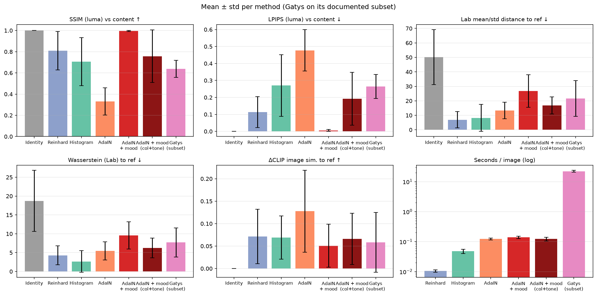
*Figure 1 — Mean ± std per method (Gatys on its subset).*

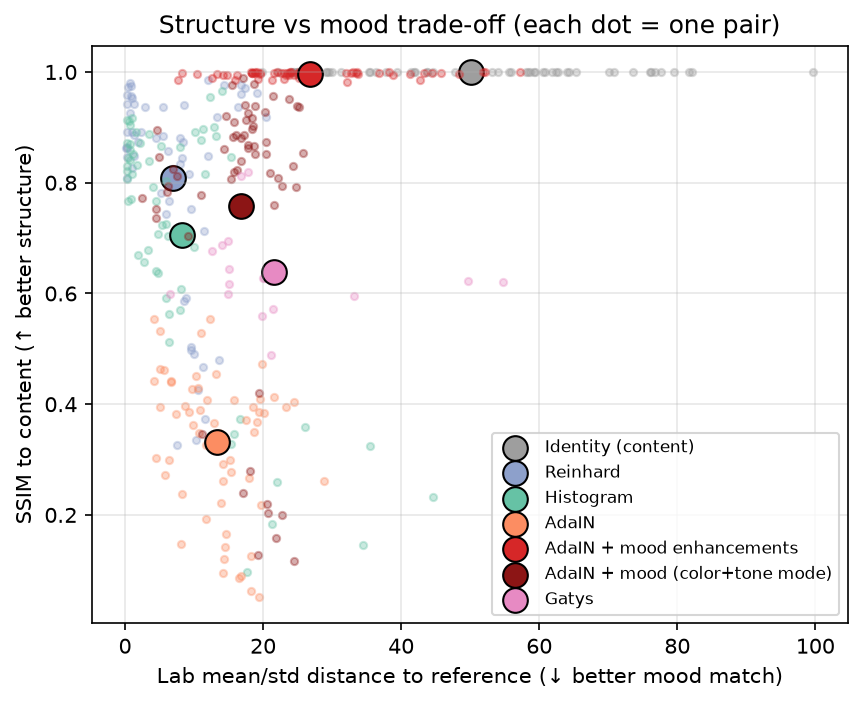
*Figure 2 — Structure (SSIM) vs. colour-statistics match (Lab distance); each small dot is one pair.*

**Table 3 — Speed (seconds per image, mean of 3 pairs, after warm-up; `results/speed.csv`).**

| Method | Apple M5 CPU | Apple M5 GPU (MPS) |
|---|---|---|
| Reinhard (512 px) | 0.010 | 0.011 |
| Histogram, Lab (512 px) | 0.042 | 0.042 |
| AdaIN (512 px) | 0.546 | 0.091 |
| AdaIN + mood, color (512 px) | 0.391 | 0.103 |
| AdaIN + mood, color+tone (512 px) | 0.401 | 0.117 |
| Gatys (384 px, 300 L-BFGS evals) | 57.9 | 20.6 |

No CUDA GPU was available, so "GPU" means Apple MPS. The classical methods run in NumPy/OpenCV on the
CPU in both columns. On CPU, AdaIN + mood was measured slightly faster than plain AdaIN; the plain-AdaIN
CPU number has a large spread (± 0.14 s) and the difference is within noise.

**Table 4 — Per-mood view (mean over the 10 contents).**

| Mood | SSIM ours (color) | SSIM ours (color+tone) | SSIM Reinhard | ΔCLIP text ours (color) | ΔCLIP text ours (color+tone) | ΔCLIP text Reinhard | ΔCLIP text AdaIN |
|---|---|---|---|---|---|---|---|
| Cold Blue Dusk | 0.997 | 0.880 | 0.928 | 0.076 | 0.076 | 0.069 | 0.058 |
| Dark Noir | 0.997 | 0.231 | 0.449 | 0.110 | 0.193 | 0.177 | 0.175 |
| Foggy / Misty | 0.998 | 0.792 | 0.879 | 0.057 | 0.080 | 0.065 | 0.060 |
| Golden Hour | 0.992 | 0.857 | 0.932 | 0.108 | 0.103 | 0.078 | 0.125 |
| Neon Night | 0.995 | 0.881 | 0.850 | 0.085 | 0.097 | 0.098 | 0.120 |
| Vintage Film | 0.997 | 0.903 | 0.817 | 0.082 | 0.099 | 0.045 | 0.036 |

**Reading the numbers.**

1. **Structure.** Our default pipeline keeps the content essentially intact (SSIM 0.996, LPIPS 0.006),
   by far the best of all methods that change the image. Plain AdaIN destroys structure (SSIM 0.331,
   LPIPS 0.477) and Gatys is in between (0.638). This is the quantitative version of "AdaIN looks
   painterly on photos".
2. **Colour statistics.** Reinhard and histogram matching have the best Lab/Wasserstein/Bhattacharyya
   scores. This is expected, not a weakness of the deep methods: those metrics measure exactly the
   global statistics that the classical methods optimise. Our default colour mode deliberately keeps
   the content's L*, so it halves the Lab distance (50.1 → 26.8) but cannot close it. The color+tone mode
   adds a monotone tone curve and reaches 16.8, better than Gatys (21.6 on its subset), while staying
   photographic.
3. **Perceived mood (CLIP).** Plain AdaIN has the highest image–image ΔCLIP (0.128), partly because it
   also copies *texture*, which CLIP image embeddings are sensitive to. Against **text descriptions** of
   the mood, our color+tone mode has the highest gain of all methods (0.108 vs. 0.096 AdaIN,
   0.089 Reinhard), and the default colour mode (0.086) is on par with Reinhard while keeping the
   structure essentially perfect. Per mood, ours (colour) beats Reinhard on golden hour, blue dusk and
   vintage film.
4. **SSIM of the tone modes.** The color+tone SSIM (0.757) is pulled down almost entirely by **Dark
   Noir** (0.231): darkening an image by a large amount changes SSIM's luminance and contrast terms and
   crushes shadow detail. On the other five moods it averages 0.863, comparable to Reinhard (0.809 on
   all six moods).
5. **Speed.** AdaIN + mood runs at ~0.1 s per 512 px image on the laptop GPU (≈10 fps) and ~0.4 s on CPU,
   about **200× faster than Gatys** on the same device (20.6 s on MPS, 57.9 s on CPU, at a smaller size).
   The mood layer (Lab conversion + colour guided filter, + tone curve) adds only ~12–26 ms on MPS.

### 6.3 Qualitative comparison
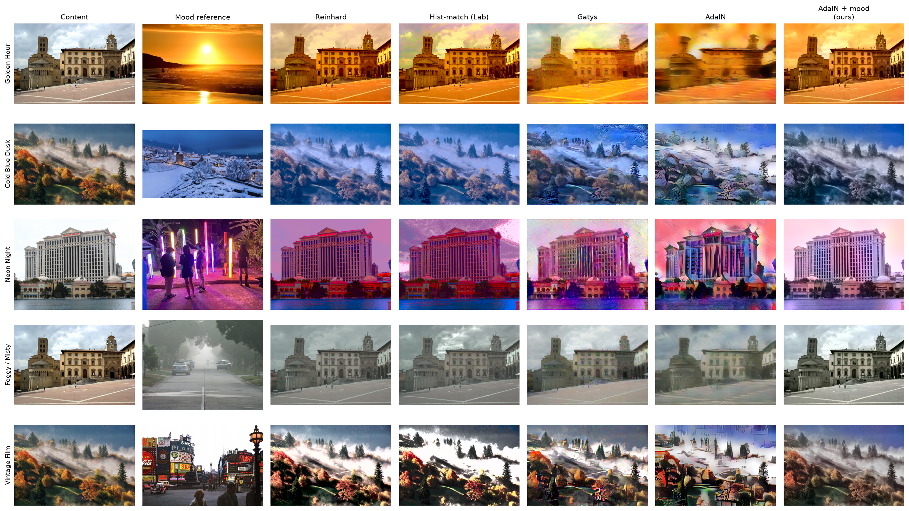
*Figure 3 — Content | reference | Reinhard | histogram matching (Lab) | Gatys | AdaIN | AdaIN + mood
(ours, default). Rows were picked from the Gatys subset so that every column is populated. All 60 × 6
outputs are in `results/outputs/<method>/`.*

The classical methods colour the whole image with the reference's global statistics. They are often
convincing (golden hour), but histogram matching creates speckle and posterised skies (neon, vintage
rows), and both spread colours with no regard for scene content. Gatys gives the right colours but with
blotchy, painterly texture. Plain AdaIN produces the strongest mood but warps buildings and trees.
Ours keeps every edge of the content and moves the colour palette clearly towards the reference.

### 6.4 Strength α
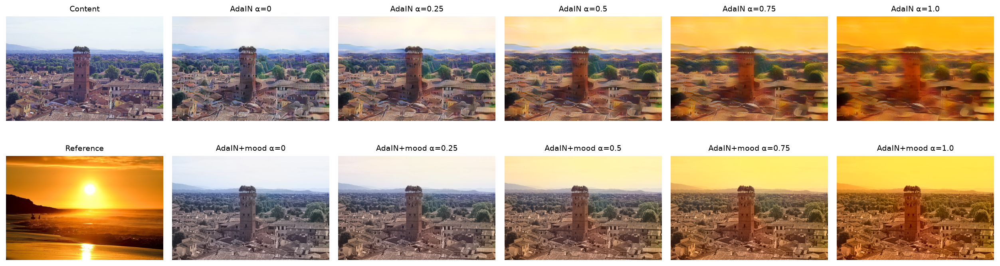
*Figure 4 — α = 0, 0.25, 0.5, 0.75, 1 for plain AdaIN (top) and AdaIN + mood (bottom). At α = 0 the
AdaIN row shows the decoder's reconstruction of the content (encoder/decoder compatibility check).*

α interpolates smoothly in feature space. In plain AdaIN, structure degrades as α grows; in our pipeline
only the colour changes, and the structure is identical for every α.

### 6.5 Transfer modes
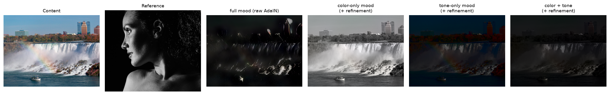
*Figure 5 — Full / colour-only / tone-only / colour+tone with the Dark Noir reference.*

With a noir reference, the *colour-only* mode removes colour (the reference's chroma is ≈ 0) but keeps
the bright daylight luminance. The result is a clean black-and-white photo, but not "dark". The
*tone-only* mode keeps the original colours and applies the noir tone curve (dark, high contrast). The
*colour+tone* mode combines both and is the closest to the noir mood without the hallucinated shapes of
raw AdaIN. This is why the mode is user-selectable.

### 6.6 Photorealistic refinement (before / after)
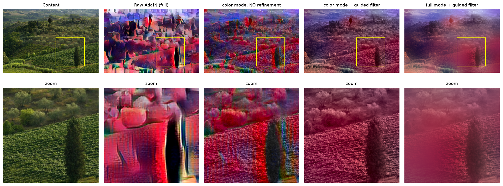
*Figure 6 — Raw AdaIN, colour mode without refinement, colour mode + guided filter (ours), and full mode
+ guided filter, with zoomed crops.*

Luminance SSIM to the content for this example (`results/refinement_ssim.json`): raw AdaIN **0.222**,
colour mode without refinement **0.980**, **colour mode + guided filter 0.994**, full mode + guided
filter 0.737. Keeping L* removes the geometric distortion. The guided filter then removes the
colour speckle that AdaIN's texture leaves in the chroma channels. Applying the guided filter to the
*full* AdaIN output removes texture but cannot undo the low-frequency warping. Both steps are needed.

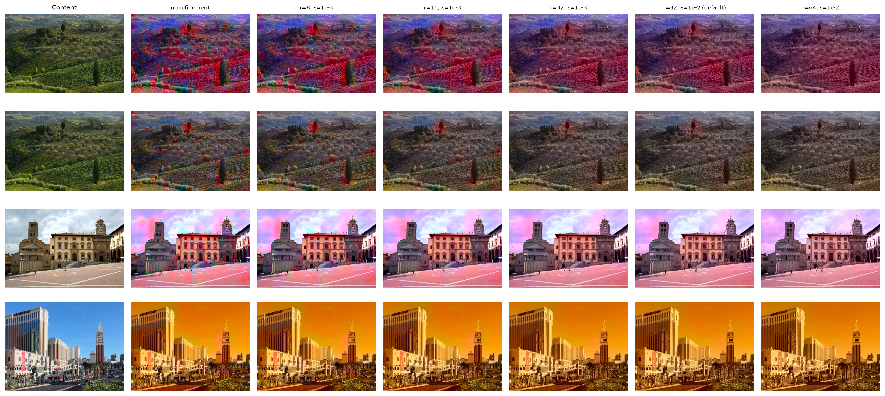
*Figure 7 — Guided-filter radius/ε ablation (colour mode) on four pairs, with radii scaled to 512 px.*

| Setting | mean SSIM to content | high-frequency chroma energy ↓ |
|---|---|---|
| no refinement | 0.987 | 4.41 |
| r = 8, ε = 1e-3 | 0.993 | 2.14 |
| r = 16, ε = 1e-3 | 0.994 | 2.17 |
| r = 32, ε = 1e-3 | 0.995 | 2.18 |
| **r = 32, ε = 1e-2 (default)** | **0.995** | **1.96** |
| r = 64, ε = 1e-2 | 0.995 | 1.91 |

Any refinement halves the high-frequency chroma noise. Larger windows additionally remove the
*low-frequency* colour blotches visible in Figure 7 (e.g. pink/blue patches in the Arezzo sky), which the
high-frequency measure does not capture. We chose r = 32 px (at 512 px), ε = 1e-2 visually as the best
compromise. r = 64 scores about the same; we did not observe a clear visual gain, and much larger windows
let colour bleed across boundaries (failure case 4).

### 6.7 Multi-reference blending
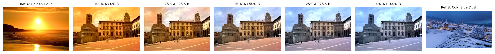
*Figure 8 — Mixing Golden Hour and Cold Blue Dusk statistics with weights 100/0 … 0/100.*

The transition is smooth and passes through plausible intermediate moods (a warm–cool "pastel dusk" at
50/50), because the weighted statistics move continuously in feature space.

### 6.8 Mood descriptors and presets
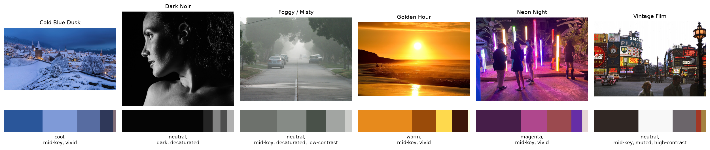
*Figure 9 — The six presets, their k-means Lab palettes (widths ∝ share) and rule-based labels.*

The labels match intuition: Cold Blue Dusk = "cool, mid-key, vivid"; Dark Noir = "neutral, dark,
desaturated"; Foggy = "neutral, mid-key, desaturated, low-contrast"; Golden Hour = "warm, mid-key,
vivid"; Neon Night = "magenta, mid-key, vivid"; Vintage Film = "neutral, mid-key, muted,
high-contrast". Full values are in `results/mood_descriptors.json`. A first version labelled neon
"warm" because its warmth score mixed a* (red–green) and b* (yellow–blue); the rule now separates
magenta casts (high a*, low b*) from warm light (high b*).

### 6.9 Post-processing
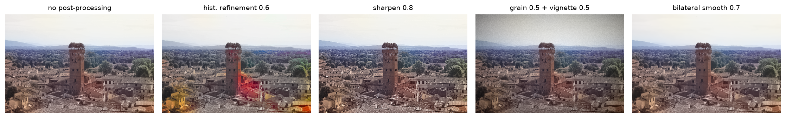
*Figure 10 — Optional post-processing on an AdaIN + mood result (Vintage Film reference).*

Grain + vignette gives a convincing "film" look, and sharpening restores a little crispness lost to the
decoder. **Chroma histogram refinement is risky:** at 0.6 it creates saturated red/yellow patches,
because CDF matching maps the content's chroma distribution onto the reference's long tail of
saturated sign colours. This is why all post-processing is off by default and exposed as sliders.

### 6.10 Semantic-aware transfer (stretch goal)
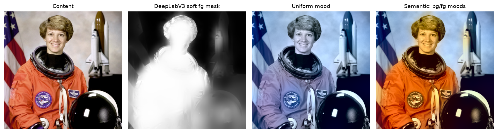
*Figure 11 — DeepLabV3 foreground mask (refined with a guided filter), uniform Cold Blue Dusk mood, and
semantic transfer with blue dusk on the background and golden hour on the person.*

The stretch goal was implemented and works on images that contain PASCAL-VOC objects. None of our 10
landscape/city content images contain such objects (the predicted foreground fraction was 0 for all of
them), so the demonstration uses the public-domain NASA *astronaut* image. A sky/ground split would need a
model trained with a "sky" class (e.g. ADE20K); VOC has none.

### 6.11 Failure cases
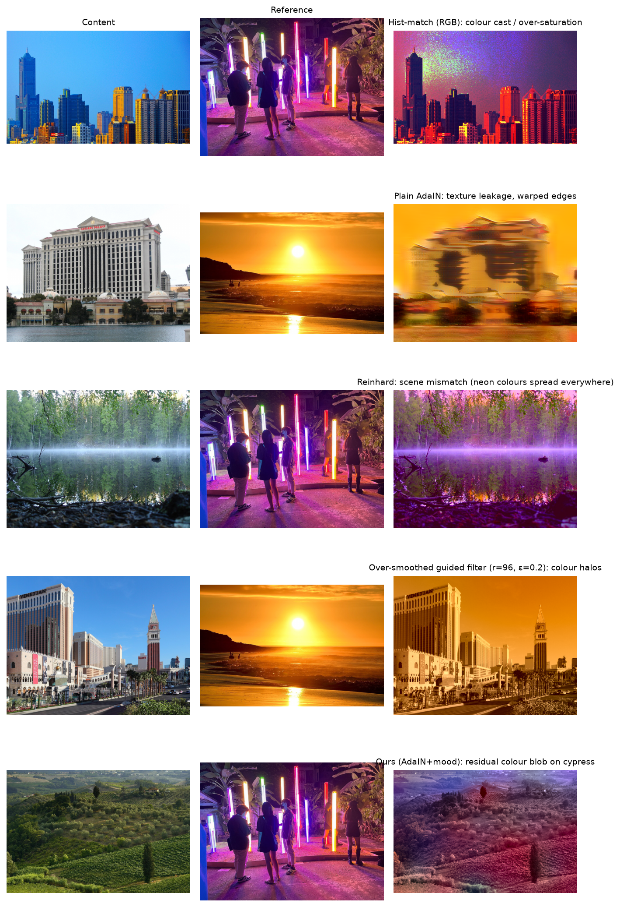
*Figure 12 — Failure cases.*

1. **Histogram matching in RGB — colour cast and over-saturation, plus noise** (Kaohsiung skyline × Neon
   Night). Matching R, G and B independently ignores their correlation. The smooth blue sky is mapped
   onto the reference's multi-modal distribution, producing posterised magenta noise and saturated red
   buildings.
2. **Plain AdaIN — texture leakage and warped edges** (Caesars Palace × Golden Hour). The decoder
   reproduces painting-like strokes; straight architectural lines and windows are destroyed. This is the
   main motivation for the mood layer.
3. **Reinhard — scene-content mismatch** (forest lake × Neon Night). Global statistics of a dark, pink
   night scene are forced onto a green daylight forest. The whole image turns purple, including the
   water and the trees, because Reinhard has no notion of what should be lit by neon.
4. **Over-smoothed guided filter — colour halos** (Las Vegas × Golden Hour, r = 96, ε = 0.2). With a very
   large window and weak edge-awareness, the colour model can no longer follow object boundaries. The
   orange of the sky bleeds over the buildings and the result looks like a uniform sepia filter. This is
   why the radius was tuned (Section 6.6).
5. **Our method — residual colour blob** (vineyard × Neon Night). AdaIN sometimes places a strong
   reference colour (red) on one object (the cypress tree) as a low-frequency blob. Because the blob is
   larger than smooth regions of the guide, it survives the guided filter. Semantic correspondence
   (Luan et al. [5]) or stronger smoothing on small objects would be needed.

---

## 7. Discussion

### 7.1 Strengths
* **Photographic results by construction.** Keeping L* and refining chroma with a guide-constrained,
  locally affine model makes it nearly impossible to introduce new edges or textures (SSIM 0.996).
* **Deep features choose the colours.** Unlike Reinhard, the colour placement comes from the decoder
  working on 512-channel VGG statistics, so colours can vary with local content rather than following
  one global affine map. Ours beats Reinhard on CLIP-text gain for golden hour, blue dusk and vintage
  film, which is consistent with this (though not proof of it).
* **Fast and controllable.** ~0.1 s per image on a laptop GPU, with α, modes, blending and post-processing
  exposed in the CLI and GUI.
* **Honest, modular baselines.** Every method shares the same I/O and evaluation code, so the comparison
  is like for like.

### 7.2 Limitations
* **Colour-only mode under-transfers brightness-driven moods.** Noir and night moods are mostly about
  tone; the default mode turns them into clean black-and-white or tinted daylight photos. The
  color+tone mode fixes this at the cost of SSIM. Choosing the mode per mood automatically (e.g. from
  the descriptor) is future work.
* **No relighting.** Global statistics cannot move shadows, add a low sun or turn on street lights. A
  midday photo with a golden-hour palette is still lit from above.
* **Scene mismatch.** A neon-night reference applied to a forest has no correspondence between
  objects. All methods, ours included, can only redistribute colours plausibly (Section 6.11).
* **Residual AdaIN blobs** on small objects can survive the refinement (failure case 5).
* **Decoder resolution.** The AdaIN decoder works at 1/8 resolution and was trained on WikiArt styles.
  Its α = 0 reconstruction is only approximate (SSIM ≈ 0.6 at 512 px), which is irrelevant in colour
  mode but limits the full mode.
* **Metrics are proxies.** SSIM penalises intended tone changes; global colour statistics favour the
  classical methods by construction; CLIP image similarity rewards copied texture. No single number
  captures "the mood is right and it still looks like a photo". A user study (Appendix A) would be the
  definitive test, but none was conducted.
* **Descriptor heuristics.** The label thresholds were set by hand on the six presets, and McCamy's CCT
  formula is unreliable far from the Planckian locus (strongly coloured images hit the 25 000 K clip).
* **Semantic mode** is limited to VOC object classes (no sky), and our landscape test set contains none.

### 7.3 Ethical notes
Mood transfer is image manipulation. It can make a real scene look more dramatic, gloomier or more
idyllic than it was, which matters in journalism, real-estate and tourism advertising, legal evidence
and social media. Edited images should be disclosed as such. Our tool keeps no data and runs locally.
All images used here are freely licensed and credited (`data/*/CREDITS.md`), and the pretrained models are
used under their respective licences.

---

## 8. Conclusion and Future Work

We built a complete mood-transfer system whose core is deep learning (pretrained VGG-19 with Gatys
optimisation and AdaIN) and whose output stays photographic thanks to a mood layer grounded in
classical DIP: colour-space separation of structure and chroma, an edge-preserving guided filter that
uses the content as guide, tone curves from histogram specification, and colour statistics for
description and evaluation. On 60 content–mood pairs, plain neural transfer gave the strongest
texture/style change but destroyed structure. The classical methods matched global colour statistics
best but ignore content. Our pipeline kept structure nearly perfectly while delivering a clearly
visible, controllable mood shift, ~200× faster than Gatys.

**Future work:** (1) semantic correspondence between content and reference regions (sky↔sky,
lights↔lights) with a segmentation model that has a sky class; (2) a decoder trained specifically for
photorealism (e.g. WCT² [25] or PhotoWCT [6] unpooling); (3) automatic mode selection from the mood
descriptor; (4) local relighting (shadows, light sources) for true time-of-day changes; (5) temporal
consistency for video; (6) a user study with the template below.

---

## Appendix A — User-study template (not conducted)

*Setup:* 12 participants; 20 random content–mood pairs; for each pair show the content, the reference
and the outputs of 4 methods (Reinhard, Gatys, AdaIN, ours) in random order, unlabeled.

1. *Mood match:* "Which image best captures the mood/atmosphere of the reference?" (pick one)
2. *Photorealism:* "Rate how much each image looks like an unedited photograph." (1–5 Likert)
3. *Content preservation:* "Are all objects of the original image still clearly recognisable?" (1–5)
4. *Artefacts:* "Do you see any unnatural textures, halos or colour blotches?" (yes/no + where)
5. *Overall preference:* "Which result would you post/use?" (pick one)

*Analysis:* preference shares with 95 % binomial confidence intervals; Likert means with a Friedman test
across methods and Wilcoxon post-hoc tests (Holm-corrected).

## Appendix B — Reproduction

```
python -m venv .venv && .venv/bin/pip install -r requirements.txt
python scripts/download_weights.py
python scripts/run_experiments.py --speed     # all tables and figures in this report
python scripts/export_pdf.py                  # this PDF
pytest -q
```

---

## References

1. E. Reinhard, M. Ashikhmin, B. Gooch, P. Shirley. *Color transfer between images.* IEEE Computer Graphics and Applications, 21(5):34–41, 2001.
2. L. A. Gatys, A. S. Ecker, M. Bethge. *Image style transfer using convolutional neural networks.* CVPR, 2016.
3. X. Huang, S. Belongie. *Arbitrary style transfer in real-time with adaptive instance normalization.* ICCV, 2017.
4. J. Johnson, A. Alahi, L. Fei-Fei. *Perceptual losses for real-time style transfer and super-resolution.* ECCV, 2016.
5. F. Luan, S. Paris, E. Shechtman, K. Bala. *Deep photo style transfer.* CVPR, 2017.
6. Y. Li, M.-Y. Liu, X. Li, M.-H. Yang, J. Kautz. *A closed-form solution to photorealistic image stylization.* ECCV, 2018.
7. K. He, J. Sun, X. Tang. *Guided image filtering.* IEEE TPAMI, 35(6):1397–1409, 2013 (ECCV 2010).
8. K. Simonyan, A. Zisserman. *Very deep convolutional networks for large-scale image recognition.* ICLR, 2015.
9. Z. Wang, A. C. Bovik, H. R. Sheikh, E. P. Simoncelli. *Image quality assessment: from error visibility to structural similarity.* IEEE TIP, 13(4):600–612, 2004.
10. R. Zhang, P. Isola, A. A. Efros, E. Shechtman, O. Wang. *The unreasonable effectiveness of deep features as a perceptual metric.* CVPR, 2018.
11. A. Radford et al. *Learning transferable visual models from natural language supervision.* ICML, 2021.
12. M. Cherti et al. *Reproducible scaling laws for contrastive language-image learning.* CVPR, 2023.
13. L.-C. Chen, G. Papandreou, F. Schroff, H. Adam. *Rethinking atrous convolution for semantic image segmentation.* arXiv:1706.05587, 2017.
14. A. Howard et al. *Searching for MobileNetV3.* ICCV, 2019.
15. C. Tomasi, R. Manduchi. *Bilateral filtering for gray and color images.* ICCV, 1998.
16. R. C. Gonzalez, R. E. Woods. *Digital Image Processing*, 4th ed. Pearson, 2018.
17. C. S. McCamy. *Correlated color temperature as an explicit function of chromaticity coordinates.* Color Research & Application, 17(2):142–144, 1992.
18. D. Hasler, S. Süsstrunk. *Measuring colourfulness in natural images.* Proc. SPIE 5007, Human Vision and Electronic Imaging VIII, 2003.
19. Y. Li, N. Wang, J. Liu, X. Hou. *Demystifying neural style transfer.* IJCAI, 2017.
20. D. Ulyanov, A. Vedaldi, V. Lempitsky. *Instance normalization: the missing ingredient for fast stylization.* arXiv:1607.08022, 2016.
21. T.-Y. Lin et al. *Microsoft COCO: Common objects in context.* ECCV, 2014.
22. F. Pitié, A. Kokaram, R. Dahyot. *N-dimensional probability density function transfer and its application to colour transfer.* ICCV, 2005.
23. M. Everingham, L. Van Gool, C. K. I. Williams, J. Winn, A. Zisserman. *The PASCAL Visual Object Classes (VOC) challenge.* IJCV, 88(2):303–338, 2010.
24. D. C. Liu, J. Nocedal. *On the limited memory BFGS method for large scale optimization.* Mathematical Programming, 45:503–528, 1989.
25. J. Yoo, Y. Uh, S. Chun, B. Kang, J.-W. Ha. *Photorealistic style transfer via wavelet transforms.* ICCV, 2019.
